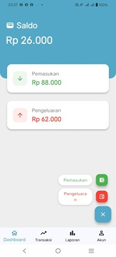
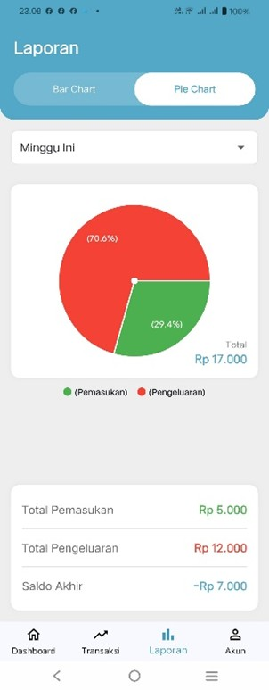
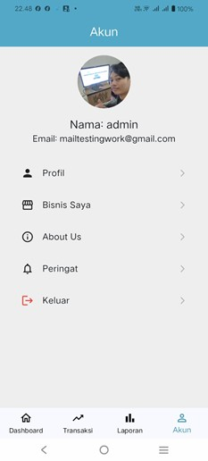

# Gerobak Digital — Mobile Financial Management App

## About the Project

Gerobak Digital is a mobile application developed as part of a collaborative team project. The application is designed to help Micro, Small, and Medium Enterprises (MSMEs/UMKM) and general users manage and monitor their finances.

The application focuses on recording income and expenses and providing monthly financial reports to help users understand their financial activities.

## Project Objectives

- Simplify income and expense recording.
- Help MSMEs and individuals monitor their finances.
- Organize financial records in one application.
- Provide monthly financial summaries to support financial monitoring.

## Key Features

### 1. Financial Dashboard
Provides an overview of financial information to help users monitor their financial condition.

### 2. Income Tracking
Allows users to record incoming money from business activities or other sources.

### 3. Expense Tracking
Allows users to record outgoing money and monitor their spending.

### 4. Monthly Financial Reports
Helps users review monthly income and expenses through financial summaries.

## Project Information

| Category | Details |
|---|---|
| Project Name | Gerobak Digital |
| Application Type | Mobile Application |
| Project Focus | Financial Management |
| Target Users | MSMEs (UMKM) and General Users |
| Development Type | Collaborative Team Project |
| Project Documentation | GitHub |

## Technology Stack

The original source code is currently unavailable. Therefore, the technical stack is not listed here until it can be verified.

## Team Collaboration

Gerobak Digital was developed collaboratively as a team project.

The project involved working together to develop a mobile application focused on financial recording and monitoring.

### My Contribution

My individual responsibilities and contributions will be documented based on the tasks I personally completed during the project.

## Application Screenshots

### 1. Dashboard

### 2. Financial Reports

### 3. User Account

## Project Status

This repository serves as a documentation and portfolio showcase for Gerobak Digital.

The original source code is currently unavailable, so this repository does not contain a runnable version of the application.

## Lessons Learned

This project provided an opportunity to participate in a collaborative mobile application development project focused on financial management for MSMEs and individual users.

---

*Gerobak Digital — Supporting more organized financial recordkeeping.*
